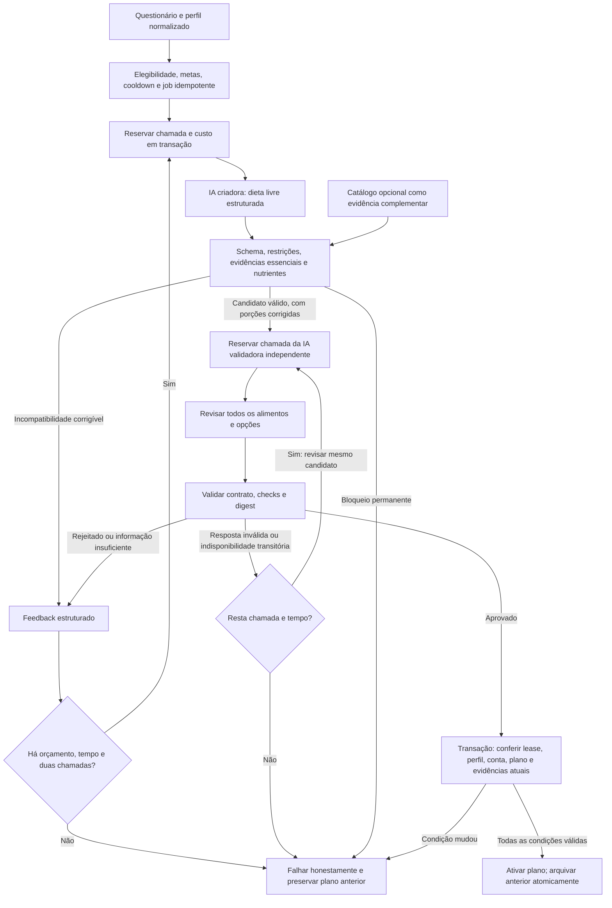

# AJ Fit — criadora e validadora independentes, 20/10/2026

**Veredito: APTO PARA HOMOLOGAÇÃO.** Implementação local concluída, com testes determinísticos e Firestore Emulator. Isso autoriza avaliação do código, não publicação: não houve deploy, build EAS, TestFlight, commit, push, alteração de dados de produção ou chamada paga à IA. A publicação integral continua dependendo da pendência separada de Rules de treino e da validação real autorizada.

## 1. Inventário e preservação

Branch `main`, HEAD `18c27fc98439c7722b979592494a0eb57cb92bf7`, sem mudança de HEAD. O inventário inicial desta tarefa contém 322 entradas de arquivos no porcelain completo, incluindo alterações, exclusões e arquivos não rastreados de trabalhos anteriores. Não houve reset, checkout, clean ou stash. O patch inicial e o status foram preservados em `/tmp/ajfit-dual-ai/initial.patch` e `initial-status.txt`.

Foram lidos o código atual, diffs/histórico e o [relatório anterior](../../final-publication-audit-2026-10-20/REPORT.md). As alterações preexistentes incluem nutrição, remoção musculoesquelética, pergunta informativa restaurada, substituições manuais, Rules pendentes e mudanças independentes de interface/mídia/assinatura. Elas não foram tratadas como um único trabalho. [FILES.json](FILES.json) distingue o delta desta tarefa; [preservation.json](preservation.json) compara os diffs iniciais/finais e confirma a preservação dos arquivos existentes e dos diffs fora do escopo. O teste de prompt anteriormente não rastreado também recebeu acréscimos, sem substituir seus casos anteriores.

Os cinco endpoints de treino (`initializeWorkoutProgramV127`, `authorizeWorkoutLifecycleMutation`, `installActiveWorkoutProgram`, `applyExerciseSubstitution`, `finalizeWorkoutSession`), questionário físico e `firestore.rules` não foram editados nesta tarefa. Scripts existentes regeneraram cópias compartilhadas ignoradas pelo Git para TypeScript/build local. Não houve mudança de dependências. Foram consultadas as [docs Expo v56 exigidas por AGENTS.md](https://docs.expo.dev/versions/v56.0.0/); o SDK instalado não foi migrado.

## 2. Arquitetura anterior

`requestNutritionPlanGeneration` aplicava autenticação, elegibilidade, rollout, cooldown e single-flight e criava um job. Trigger/scheduler carregavam perfil e metas do motor nutricional, resolviam nomes de preferências, chamavam uma IA e validavam schema, restrições e nutrientes antes da transação de ativação. Alternativas tinham caminho equivalente com metas fixas da refeição. O plano anterior só era arquivado na ativação bem-sucedida.

Havia dois caminhos: freeform e intenção ligada ao catálogo. No freeform, `critical_absence_requires_catalog` bloqueava exclusões críticas antes de tentar gerar; no segundo, todos os itens precisavam resolver no catálogo. Existiam três tentativas de criação, `gpt-6-luna` primário e promoção final possível a `gpt-6.1-sol` para certos erros. Não havia segunda avaliação independente nem teto monetário persistido de todas as chamadas. Recusa opaca e incompatibilidade de conteúdo já haviam recebido códigos próprios no trabalho local anterior.

O relatório anterior constatou flag de catálogo desligada e zero registros publicados com ausência declarada de lactose. **Essas constatações não foram consultadas novamente em produção nesta tarefa.** O novo caminho elimina o bloqueio global: alimentos comuns identificados podem compor uma dieta sem qualquer registro prévio. A ausência de prova essencial de um produto específico continua impedindo o uso daquele produto.

## 3. Arquitetura implementada

`runReviewedGeneration` é o orquestrador comum de planos e alternativas. Não recebe uma lista fechada de alimentos permitidos. `critical_absence_requires_catalog` foi retirado do caminho de produção; flags/modos antigos não tornam o catálogo obrigatório. Helpers antigos permanecem para documentos históricos e funcionalidades ligadas ao catálogo.

Estados públicos continuam `queued`, `running`, `validating`, `completed`, `failed`; não foi criado estado que exija atualização obrigatória do listener antigo. O orçamento é gravado antes do HTTP, e a posse do job usa token de lease. Cada tentativa reaplica as validações. Rascunhos rejeitados não são salvos como planos/alternativas. O plano anterior, histórico, metas, cooldowns e restauração existentes foram preservados.

## 4. Modelos, entradas e prompts

Ambos os papéis usam **`gpt-6-luna`**, com chamadas Responses separadas, sem histórico compartilhado/`previous_response_id`, `store:false`, Standard `service_tier:default`, `truncation:disabled` e esforço `low`. Independência aqui significa contexto, chamada e responsabilidade separados; não significa pesos/modelos diferentes. O identificador de fallback caro permanece por compatibilidade histórica, mas nenhum pedido novo o seleciona, mesmo com a flag antiga.

Criadora: `FULL_PLAN_SYSTEM_PROMPT` / `MEAL_ALTERNATIVE_SYSTEM_PROMPT` em `ai/prompt.ts`, versão `nutrition-full-plan-v4.0.0`, schema de geração `3.1.0`. Recebe objetivo, dados físicos relevantes, perfil alimentar, suplementos selecionados, metas do motor, tolerâncias, preferências/usos/exclusões e feedback de correção. O plano inicial mantém uma opção por refeição; alternativas continuam sob demanda. Ingredientes, origens e nutrientes estimados são obrigatórios. Dados e feedback não têm autoridade para alterar instruções.

Validadora: `REVIEW_SYSTEM_PROMPT` em `ai/review.ts`, versão `nutrition-independent-review-v1`. Recebe perfil, contexto físico, metas/tolerâncias, candidato completo **depois** da correção determinística de porções, digest e observações verificadas pelo backend. Examina todas as alternativas, plausibilidade dos nutrientes, composição, restrições e preferências. Não cria uma dieta substituta nem recebe pedido para aprovar a qualquer custo. Não usa declaração da criadora ou memória do modelo como prova de rótulo/certificação.

O segredo permanece exclusivamente no backend. Não foi acrescentado serviço externo ou dependência. A implementação segue as [Structured Outputs oficiais](https://developers.openai.com/api/docs/guides/structured-outputs), complementadas por validação de runtime — JSON conforme schema não equivale a aprovação nutricional.

## 5. Contrato da revisão e política de aprovação

O schema efetivamente compilado está em [validator.schema.json](validator.schema.json), com objetos fechados e todos os campos obrigatórios:

| Campo | Contrato |
| --- | --- |
| `candidateDigest` | SHA-256 do candidato; precisa corresponder exatamente |
| `status` | `approved`, `rejected`, `insufficient_information` |
| `checks` | Dez booleanos obrigatórios: allergies, lactose, gluten, dietaryPattern, ingredients, quantities, macros, calories, preferences, evidence |
| `issues` | Até 12 ocorrências: categoria fechada, severity high/medium, índices nullable de refeição/opção/alimento, reason e suggestedCorrection |
| `requiresRegeneration` | Booleano obrigatório |

O parser adicional exige textos de ocorrência não vazios, até 400 caracteres, índices inteiros entre 0 e 99 ou null, ausência de campos extras e consistência entre os campos. Aprovação exige **todos** os checks verdadeiros, zero ocorrências e `requiresRegeneration=false`. Rejeição/informação insuficiente exige ocorrências e regeneração. Digest errado, resposta parcial, ausente, contraditória ou inválida falha de forma fechada.

Uma rejeição envia à criadora o candidato anterior e feedback estruturado; o próximo candidato passa novamente por código e outra revisão. Erro transitório de comunicação/schema da validadora repete somente a revisão do mesmo candidato, dentro do orçamento; não paga outra criação sem necessidade. Rejeição real não solicita outra opinião sobre o mesmo candidato para tentar obter aprovação. Esgotar tentativas nunca aprova.

## 6. Segurança, lactose, whey e catálogo

- `wheyAccepted` expressa a seleção do suplemento, condicionada a veganismo e alergia ao leite. Lactose, sozinha, não torna a flag falsa. `proteinSupplementAccepted` mantém a seleção de proteínas inclusive vegetais. Isso não libera um item concreto: seleção e evidência são conferidas separadamente.
- Alimentos comuns identificáveis e preparações caseiras com ingredientes claros podem passar sem catálogo, inclusive para vegetarianos intolerantes que desejam mandioca. O código bloqueia ingredientes sabidamente incompatíveis, mesmo quando a criadora declara origem incorreta ou uma revisão mock aprova.
- Whey genérico/isolado/hidrolisado e formulações comerciais relevantes sem prova permanecem desconhecidos e são rejeitados para correção. Não se deduz ausência de lactose pelo processamento ou nome. Proteína vegetal comercial também não é automaticamente prova de ausência de alergênicos.
- Produtos que dependem de ausência verificada exigem identidade exata e evidência do backend: composição revisada estritamente `true`, referência, ausência aplicável e revisão correspondente. A IA não fornece ID, certificado ou atestado confiável. Dados nutricionais e alergênicos disponíveis do produto acompanham a revisão.
- Ingredientes explicitamente incompatíveis na receita não são desculpados por um registro de catálogo que diga “zero”. Uma menção caseira também não encobre um ingrediente industrializado desconhecido; alegações de laudo/certificação não são aceitas sem fonte, inclusive sem restrição alimentar.
- Evidências utilizadas são relidas na transação de persistência, com fingerprint de revisão, nome/marca, evidência, status e alergênicos. Alteração/revogação impede ativação, mesmo após aprovação da IA.
- Alergia legada `excludedAllergens:['milk']` continua alergia à proteína, sem conversão; whey zero lactose permanece incompatível. Foram reforçados nomes de derivados como caseinato/caseinate/lactoalbumina/lactoglobulina.
- Schema, números finitos, composição, exclusões, porções representáveis, metas por refeição, totais diários e correção determinística existente permanecem. Tolerâncias existentes não foram relaxadas: frações diárias de 5% kcal, 10% macros e 20% fibra, além das faixas por refeição calculadas pelo motor.

O catálogo é fonte opcional para o conjunto da dieta e continua necessário quando é a única fonte confiável disponível para afirmar uma propriedade essencial de um produto específico. Falha de consulta não vira confirmação de ausência. Alimentos excluídos por ID ainda precisam de identidade recuperável: perfil com exclusão pessoal impossível de identificar não pode ser silenciosamente ignorado. Isso é integridade da restrição, não uma lista obrigatória de alimentos permitidos.

## 7. Erros, recuperação e compatibilidade de mensagens

| Código | Significado |
| --- | --- |
| `AI_PROVIDER_REFUSAL` | Recusa da criadora; transitória dentro do teto |
| `AI_REVIEW_PROVIDER_REFUSAL` | Recusa da validadora, sem atribuir condição clínica |
| `AI_PROVIDER_ERROR`, `AI_TIMEOUT`, `AI_RATE_LIMIT` | Comunicação/timeout/limite da criadora; retry conforme classificação HTTP |
| `AI_REVIEW_UNAVAILABLE`, `AI_REVIEW_TIMEOUT`, `AI_REVIEW_RATE_LIMIT` | Falhas da chamada de revisão, distintas da rejeição de conteúdo |
| `AI_SCHEMA_INVALID`, `AI_REVIEW_SCHEMA_INVALID` | Respostas inválidas, por papel |
| `AI_CONTENT_SAFETY_MISMATCH` | Incompatibilidade determinística do rascunho; pode ser corrigida |
| `AI_EVIDENCE_INSUFFICIENT` | Código não tem informação essencial confiável para aquele produto |
| `AI_REVIEW_REJECTED`, `AI_REVIEW_INSUFFICIENT_INFORMATION` | Avaliação semântica desfavorável ou inconclusiva da validadora |
| `AI_SAFETY_VALIDATION_FAILED` | Causa interna histórica para bloqueio determinístico permanente, como alergia não especificada ou evidência revogada |
| `AI_DETERMINISTIC_SAFETY_BLOCKED` | Código público novo para essa causa permanente; evita o texto de gravidez que clientes antigos associavam ao código histórico |
| `AI_RETRY_EXHAUSTED` | Teto/tempo esgotado; job preserva `lastFailureCode` como causa concreta |
| `AI_COST_LIMIT_EXCEEDED` | Input/reserva/contador incompatível com o orçamento, sem aumentar limite automaticamente |

Cliente novo tem cópia honesta em PT-BR, inglês e espanhol para rejeição, indisponibilidade e esgotamento. A recusa não vira mensagem de gravidez/amamentação. Cliente antigo trata códigos desconhecidos como erro genérico conforme o código histórico inspecionado. Para novas falhas permanentes, o alias público evita a associação clínica errada; documentos de erro antigos já persistidos e texto já distribuído não foram reescritos.

## 8. Chamadas, tokens, custos e duração

Estimativa apresentada antes da implementação: duas chamadas no sucesso; quatro permitem uma correção completa. Três chamadas totais não permitem criar/revisar duas versões; seis ampliariam desnecessariamente o teto. Escolhida a alternativa de quatro, mantendo no máximo três tentativas da criadora quando falhas anteriores não chegaram à revisão.

| Limite | Criadora | Validadora |
| --- | --- | --- |
| Modelo | gpt-6-luna | gpt-6-luna |
| Entrada: limite conservador de tokens | 32.000 | 64.000 |
| Saída máxima | 8.000 | 1.500 |
| Timeout máximo por chamada | 90s | 30s |
| Reserva nominal por chamada | US$ 0,00720 | US$ 0,00715 |

**Teto global: quatro chamadas e US$ 0,03 de reserva nominal por job/request de alternativa**, todos os papéis somados, inclusive erros e retomadas. O limite de entrada usa bytes UTF-8 de prompts/contexto/schema mais 2.048 de margem como bound conservador, sem truncar restrições. Rejeita excesso antes do HTTP. Contadores/reserva e registro `pending` são gravados em transação antes de cada chamada; falha de rede ou crash nunca devolve uma reserva possivelmente consumida. Usage desconhecida permanece null, não zero.

Pelos [preços oficiais Standard consultados](https://developers.openai.com/api/docs/pricing), Luna custa US$ 0,10/M entrada e US$ 0,50/M saída; o cálculo conservador não depende de desconto de cache. Exemplo ilustrativo: criadora 3.000/2.000 tokens = US$ 0,00130; revisão 5.000/500 = US$ 0,00075; sucesso = **US$ 0,00205**, uma correção equivalente = **US$ 0,00410**. Isso aumenta o exemplo de sucesso barato em cerca de 58% em relação a uma única criação, mas elimina a promoção cara. Não é medição de IA real desta tarefa.

Máximos nominais dos formatos de quatro chamadas: três criadoras + uma revisão = US$ 0,02875; dois pares = US$ 0,02870; uma criadora + três revisões = US$ 0,02865. Reserva de US$ 0,03 é controle de software sob tabela de preços versionada, não limite de faturamento da conta; exclui impostos, câmbio e Firebase. Preços devem ser conferidos antes da publicação.

Timeouts das Functions não foram elevados. Alternativa mantém 120s e deadline interno de 110s: inicialmente até 75s para criar, preservando 30s e margem para revisão; retries dependem do tempo restante. Worker mantém 540s, com deadline interno de 430s. Um único envelope limita todas as chamadas. Cooldown de plano 15min, alternativa 20s e 12 alternativas/hora permanecem.

## 9. Persistência, concorrência e observabilidade

Plano mantém schema `2.0.0`, alimentos freeform e contratos públicos anteriores, com metadata de revisão aditiva (versão/modelo/digest/chamadas). A transação verifica conta, perfil atual, lease, job, plano ativo e evidências antes de arquivar o anterior/criar o novo. Alternativas preservam opções e metas fixas, inclusive metas armazenadas de planos antigos ligados ao catálogo.

Jobs carregam `aiCallCount`, `aiReservedUsd`, `aiAttemptCount` e lease proprietário. Alternativas usam um ledger na coleção **existente** `nutritionAiOperations`, com owner e fingerprint de plan/slot/feedback. Colisão de UUID entre usuários e reutilização com payload diferente são rejeitadas. Mesmo requestId não reinicia orçamento; sucesso é replay sem IA. Registros permanecem abrangidos pela exclusão de conta existente; nenhuma coleção ou Rule nova foi exigida.

Jobs legados parcialmente consumidos sem ledger falham de forma fechada, pois não é possível provar seu gasto anterior; jobs antigos sem chamadas podem usar o caminho novo. Em retomada após crash, rascunho não persistido pode precisar de outra criação dentro do saldo — orçamento não é reiniciado. Lease takeover impede worker antigo de reservar mais chamadas ou ativar plano.

Operações registram papel, número de chamada, tentativa, latência, usage/custo quando disponíveis e categorias fechadas de rejeição. Texto livre de rejeição/candidato/ingredientes não é salvo em logs/operations; feedback detalhado fica em memória para correção. Status distingue `pending`, `created`, `approved`, `validated`, `failed`; revisão aprovada só vira `validated` na mesma transação que salva o resultado. Par criadora/validadora não infla contagem de solicitações nem é contado como retry. Monitor separa consumo por papel sem alterar thresholds existentes.

## 10. Testes executados e auditoria adversarial

Detalhes e nomes das falhas estão em [validation.json](validation.json); comandos em [COMMANDS.md](COMMANDS.md). Suítes se sobrepõem e os totais não devem ser somados.

| Execução final | Resultado |
| --- | --- |
| TypeScript aplicativo | Aprovado |
| TypeScript Functions, incluindo testes | Aprovado |
| Compilação local Functions e inspeção de lib/index.js | Aprovada; não é EAS/deploy |
| Functions geral sem emulador | 2.084 passaram, zero falhas, 412 ignorados |
| Nutrição contra Firestore Emulator | 318 passaram, zero falhas, um smoke pago ignorado |
| Rules nutricionais locais no emulador | 20 passaram, zero falhas |
| Recuperação do cliente com rede Firestore | Um passou |
| Cliente: mensagens novas + recentAuth focado | 18 passaram |
| Aplicativo geral | 7.600 passaram, 23 falharam, 221 ignorados |
| recentAuth do HEAD isolado | Oito passaram; fonte e teste idênticos ao HEAD |

As 22 falhas gerais já documentadas têm exatamente os mesmos nomes do relatório anterior, que as reproduziu em HEAD isolado. A execução atual acrescentou `hasRecentAuth is true exactly at the boundary of the window`: teste usa relógio real antes de uma Promise e novamente depois, podendo ultrapassar a janela por 1ms. Fonte/teste não têm delta contra HEAD; passaram no rerun focado e numa cópia isolada dos mesmos arquivos do HEAD. Isso documenta falha intermitente preexistente; não foi alterada autenticação fora do escopo. A falha adicional não foi reproduzida na execução isolada, portanto não se apresenta essa execução como reprodução da falha. Nenhuma falha nutricional nova permaneceu.

| Cenários obrigatórios | Evidência |
| --- | --- |
| 1–2 vegetariano válido / com carne | Aceita alimento comum; bloqueia carne até quando origem é falsificada e revisão permissiva |
| 3–7 lactose, produto zero, composição desconhecida, whey, vegetal | Sem catálogo para comuns; aceita produto exato verificado; rejeita genérico/isolado/hidrolisado desconhecidos; aceita vegetal compatível com evidência |
| 8–10 alergia legada, glúten e alimento desejado | Leite continua alergia; trigo bloqueado; mandioca e preferências transmitidas/corrigidas |
| 11–15 aprovação, rejeição, schema inválido, indisponibilidade, recusa | Mocks explícitos; sem aprovação padrão; retry de revisão separado; códigos por papel |
| 16–17 regeneração e esgotamento | Feedback estruturado; duas versões rejeitadas nunca ativam; no máximo quatro chamadas |
| 18 plano anterior | Preservado no emulador após rejeição/esgotamento |
| 19 idempotência/concorrência | Quatro workers concorrentes, takeover durante revisão, crash, replay de alternativa e colisão entre usuários |
| 20 orçamento | Reservas antes do HTTP, saldo retido, limite conjunto, sem fallback caro, inputs e tempos limitados |

Auditoria adversarial também cobriu laudo inventado, flag de revisão malformada como string, “caseiro” escondendo ingrediente comercial, proteína do leite marcada como vegetal, glúten conhecido, todas as opções de alternativa, revisão de porções efetivamente corrigidas, digest antigo, checks ausentes/contraditórios e evidência revogada durante a chamada. Os problemas encontrados foram corrigidos e os testes finais passaram. O emulador usa projeto `demo-ajfit-dual-ai`; OpenAI é mockada e `NUTRITION_REAL_AI_SMOKE=0`.

Não executados: chamadas pagas/model accuracy benchmark, latência real, iOS nativo, EAS/TestFlight, Functions Emulator completo sob Node22 e App Check HTTP real. Handlers/transações foram exercitados em Node20.20.2 com Firestore Emulator/JDK21; runtime de produção é Node22. Testes ignorados não são aprovados. Testes gerais também cobrem lógica de questionário e prescrição; não substituem a checagem visual real da pergunta restaurada.

## 11. Arquivos e Functions afetadas

Lista exata do delta e arquivos do build está em [FILES.json](FILES.json). Backend: `ai/{config,prompt,provider,review}`, `generation/{attempts,alternative,domain,restrictions,reviewEvidence,callBudget,worker,request,mealAlternativeRequest,operations}`, `catalogLinking/resolver` e `observability/{metrics,alerts}`; testes novos e regressões existentes atualizados. Aplicativo: `src/types/nutrition.ts`, `src/nutrition/ui/generationStage.ts`, teste correspondente e traduções `nutrition.json` PT-BR/EN/ES.

Exports e dependências de `functions/src/index.ts` e `functions/lib/index.js` foram inspecionados. [compiled-impact.json](compiled-impact.json) registra o grafo de módulos locais compilados. O escopo de publicação nutricional completa desta tarefa é **exatamente seis endpoints**:

1. `requestNutritionPlanGeneration` — cria jobs com ledger/modo revisado.
2. `onNutritionGenerationJobCreated` — criadora, revisão e ativação.
3. `retryNutritionGenerationJobs` — retoma o mesmo pipeline/orçamento.
4. `requestNutritionMealAlternative` — revisão obrigatória e ledger da alternativa.
5. `monitorNutritionAiOperations` — leitura de novos status e consumo por papel.
6. `logCatalogMeal` — depende de `catalogLinking/resolver`, cuja checagem de derivados de proteína do leite foi reforçada; manter comportamento coerente em registros de planos históricos.

Não há novo endpoint público de revisão. `favoriteCatalogMeal`, `restoreNutritionPlan`, notificações e Functions de treino não precisam de deploy por este delta. Publicar somente os quatro nomes destacados inicialmente pelo pedido deixaria observabilidade e o consumidor do resolver com versões diferentes. A lista não foi inferida dos nomes de arquivos.

## 12. Compatibilidade e limitações remanescentes

Cliente antigo + backend novo conserva request/response, schema2, estados e leitura de plano; novos códigos caem no genérico e metadata é aditiva. Cliente novo + backend novo tem mensagens próprias. Backend antigo ignora campos não enviados e cliente novo aceita documentos anteriores. Essa análise se baseia no código histórico disponível, não numa auditoria de cada binário instalado.

Contas antigas mantêm alergias e planos anteriores; planos/catalog bindings históricos continuam suportados para restauração, favoritos e diário. Novo plano freeform usa os caminhos já existentes para esse formato. A flag antiga de catálogo deixa de determinar a geração. Não se exige seed de catálogo para dieta de alimentos comuns; whey comercial zero lactose continua dependendo de evidência verdadeira disponível.

**Pendência separada de publicação completa:** o relatório anterior demonstrou que Rules publicadas exigem `inputs.limits` e `inputs.primaryPlace` em certos snapshots de recuperação/`AUTOMATIC_RECONCILIATION`, enquanto o cliente novo não emite esses campos. Não foi reintroduzido campo clínico nem alterada Rule para contornar a falha. As Rules nutricionais locais passaram; a compatibilidade das publicadas para nutrição foi demonstrada no relatório anterior e não foi reconsultada nesta tarefa. Os novos writes são Admin SDK ou campos já legíveis; não há nova necessidade de gravação cliente privilegiada.

Modelos podem compartilhar erros e não fornecem prova laboratorial. A identificação determinística de categorias comerciais usa heurísticas de nomes/ingredientes, e alimentos fora delas dependem também da revisão semântica; não há garantia absoluta de detectar formulação oculta. Produtos não cobertos podem gerar rejeições conservadoras. Precisão de nutrientes estimados, qualidade real das recomendações e desempenho precisam de homologação real autorizada. Não foi alegada certificação clínica ou nutricional por testes de mocks.

## 13. Publicação futura — nenhuma fase executada

**Fase A — backend nutricional, após autorização.** Revisar diff do pacote, schema compilado, preços, credenciais/rollout já existentes e jobs em trânsito. Publicar exclusivamente os seis endpoints acima num intervalo coordenado; evitar coexistência prolongada de worker/scheduler antigo e novo. Jobs legados parcialmente consumidos sem ledger podem falhar honestamente e exigir solicitação nova após cooldown. Conferir separadamente contadores por papel, recusas, rejeições, custos e ativações; não ativar fallback caro nem preparar evidência fictícia.

**Fase B — um build iOS autorizado.** Incluir contratos/cópias desta tarefa e as alterações locais anteriores já auditadas: lactose/suplementos, tratamento de erros, pergunta informativa de limitações restaurada e retirada da lógica automática musculoesquelética. Separar mudanças independentes com base no inventário; não incluir automaticamente todo o working tree. Revisar as demais pendências de release antes de montar o único build. Nenhum dos cinco endpoints de treino deve ser republicado.

**Fase C — TestFlight autorizado.** Validar dieta inicial, regeneração/correção, indisponibilidade de revisão, plano anterior, alternativas/replay, perfis vegetarianos/veganos/lactose/glúten/alergia legada e produtos com/sem prova. Conferir questionário, progresso, treino e substituições manuais no dispositivo. Medir qualidade, custo e latência reais antes da liberação geral.

**Fase D — Rules como entrega separada.** Resolver o contrato de snapshots novos e históricos sem campos clínicos, repetir testes de autoridade/compatibilidade e só publicar após autorização específica. A fase é separada operacionalmente, mas o defeito precisa estar resolvido antes de liberar ao público o cliente afetado; a ordem A/B/C não autoriza ignorá-lo.

**APTO PARA HOMOLOGAÇÃO** — o pipeline local atende à arquitetura de duas IAs e seus testes de segurança/persistência/orçamento passaram. Publicação em produção permanece condicionada à pendência independente de Rules, às falhas preexistentes documentadas e à homologação real; nada foi publicado.
